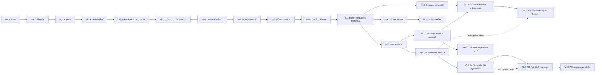

# Program roadmap

Version **0.15.3**. Normative **program milestones** for arks delivery through **CLI-parity production** (**M9**), **default product lease capability** (**M10**), **production-server** (**M11**), post-production **M12–M14**, **M15** inventory-level full CLI residual, then **M16 complete flag symmetry** (active alias bar — no production refuse leftovers), **M17 full G19 journey allow-list**, **M18 Pf4 aggressive comparative perf** (≤0.5× progressive claim; M17 ≤0.8× frozen), **M19 concurrency catalog claim expansion** (Phase **Cx** — Cx-1/Cx-2), **M20** further Cx/Cd claim expansion from researched promoteables ([[research:root/20261110021546]]), **M21 full-catalog Deferred=0** (Phase **Dz** — every ID terminal; Closed-deferred is **not** a success exit), **M22 residual terminal close** (Phase **Rc** — G8/server/Pf5/L3-refuse/judgment No leftovers terminal), **M23 L3 HighConcurrency ship** (Phase **Hc** — claimed lease+batch-apply+worktree/ref-shard shape), **M24 CELIR index dual-path / migration** (Phase **Ci** — sidecar beside `.git` + rebuild-from-`.git` + build/publish/open/query behind feature `celir-index`; ObjectStore Refuse retained), **M25 server transport expansion** (Phase **Sv2** — dumb HTTP / SSH command-mode / protocol v2 / `git://`; **G29–G32**; unlock [[adr:root/20261109220230]]; does not rewrite M11/G15), and **M26 shared-index N-way** (Phase **Si** — lease + `index.lock` on one shared index; unlock [[adr:root/20261110074000]]; gate **G34**; ≠ M24/G22/G24 substitute). Post-M24 additive gates **G26–G28** (local/smart-HTTP PR sims + live-private journeys) are Claimed; land tip for G28 offline N/A=0 close ~`902d728`. Full Symmetry ladder **FS0–FS_final Done** ([[research:root/20261110212414]]); tip operator honesty is **PARTIAL** overall ([[research:root/20261110225000]], [[research:root/20261111001816]]) — **FS_final YES**, non-FS residuals remain. This SoT is the **canonical milestone ladder** (**M0…M26**). Executable phase letters (**C→S→R→P→L→H→Pa→Pb→Pc→E→Sv→Cm→Cd→Pf→Fs→Sy→Pf3→Pf4→Cx→Dz→Rc→Hc→Ci→Sv2→Si**) remain owned by [[plan:root/20261108082148]]. Core crate packaging detail remains owned by [[plan:root/20261108082110]]. Wave-1 (M1 first wave): [[plan:root/20261108085816]]. Per-milestone staged plans: M0–M6 [[plan:root/20261108090645]]…[[plan:root/20261108090651]]; M7–M10 [[plan:root/20261108183810]]…[[plan:root/20261108183813]]; **M11** [[plan:root/20261108105446]]; **M12** [[plan:root/20261109024634]]; **M13** [[plan:root/20261109024635]]; **M14** [[plan:root/20261109024636]]; **M15** [[plan:root/20261109035335]]; **M16** [[plan:root/20261109043910]]; **M17** [[plan:root/20261109043916]]; **M18** [[plan:root/20261109125438]]; **M19** [[plan:root/20261110010000]]; **M21** [[plan:root/20261110140000]]; **M22** [[plan:root/20261110150000]]; **M23** [[plan:root/20261109194208]]; **M24** [[plan:root/20261109203430]]; CELIR object-store side track **cancelled / non-product** [[plan:root/20261108090653]]. Concurrency catalog: [[sot:root/multi-agent-git-concurrency-scenarios]] + [[research:root/20261109023117]] (221 scenarios). Hotspot research: [[research:root/20261109125438]].

If a chat summary, README, or Pages narrative disagrees with this SoT, **this SoT wins** for milestone identity and production exit. If a milestone exit and a phase exit disagree, **phase exits** win for product claims ([[plan:root/20261108082148]]); crate rings win for dependency direction ([[sot:root/crate-architecture]]).

**Supersession notes:** Prior v0.2 “Git-compat production = M6 (CLI subset)” is **revoked**. Prior “arks as Git server = Open” is **revoked** — **M11** production-server. Prior “ladder ends at M11” is **superseded** by v0.5.0 post-production **M12–M14**. Prior “active alias bar = M15” is **superseded** by v0.7.0 **M16** complete symmetry (M15 remains historical inventory close) without rewriting M9–M15 receipts. Prior tip narratives that treat historical Pf5 **8/8** at `79fc9bf` as current tip ≤0.5× are **superseded** for tip currency by **Claimed(partial)** after J-ALIAS-01 / J-REVERT-01 `aggressive_na` ([[evidence:root/20261110224814]]); M17 ≤0.8× **19/19** remains green — **no remasure thrash**.

### Tip currency (post-M26 / FS_final) — normative honesty

Carrying tip class ≥ `307d509` + U-ladder pack [[evidence:root/20261111003444]] (prior matrix [[evidence:root/20261110224814]]). **Ladder M0–M26 exits stay frozen Claimed/Closed.** No new **M27** invent; post-ladder work is reopen/ops/advisory only per residual register + [[research:root/20261111001816]].

| Scope | Status | Notes |
|-------|--------|-------|
| **M0–M26** program ladder exits | **Done** | Historical receipts frozen; do not rewrite |
| Full Symmetry **FS0–FS_final** (git feature DoD) | **Done** | Claimed rows have receipts; no casual N/A for real git features |
| Catalog Deferred=0 / residual §F terminal | **Done** | No bare development Opens |
| G19 M17 ≤0.8× (19 journeys) | **Done** | **19/19** measured; N/A-free on tip remasure |
| Pf5 / G19 aggressive ≤0.5× umbrella | **Partial** | U1 sole remasure [[evidence:root/20261111003444]]: claimed=17 + ALIAS/REVERT `aggressive_na` (ALIAS bump rolled back; REVERT 0.54 kept); **no stampede**; historical **8/8** archival |
| OBJ-004 sha1cd **detect+refuse** | **Done** | Claimed; absolute collision **immunity** stays Non-goal / Impossible |
| FS-007 / WIN-003 host-env | **Partial→Claimed(advisory+opt-in refuse)** | Detect + `ARKS_HOST_ENV_REFUSE_SYNC` / `--refuse-sync`; full sync / hydration = Non-goal |
| FS-014 SELinux/AppArmor | **Partial→Claimed(detect+errno)** | Sysfs LSM detect + honesty; bypass Impossible |
| G8 / G28 live harness | **Done** (ops) | Default-on when secrets; live-private G28 Claimed with receipts |
| Live G8 **latency SLO** remasure | **Blocked** | Secrets hard-block (`g8-live` secret count **0**); local-forge wire ≠ live PASS |
| **L9** crates.io / docs.rs timing | **Blocked** | Owner policy; reopen pack [[research:root/20261111003444]]; no unauthorized publish |
| Forge Checks / PR / OAuth UX | **Partial (Claimed-closest thin-wrap)** | `arks forge` → host `gh` + credential.helper; full forge host UX Non-goal |
| Absolute SHA-1 collision immunity | **Non-goal** | Crypto Impossible; detect+refuse is the Claimed bar |
| Full multi-device cloud-sync safety on `.git` | **Non-goal** | Advisory only (DriveFS G: useful advisory ≠ Claimed) |
| Operator one-word (“fully complete?”) | **PARTIAL** | FS_final **YES**; live G8 latency + **L9** + crypto immunity + full sync remain |

**Next milestones (post-ladder queue — not M27 invent):**

1. **Ops — Live G8 latency** — owner fills Environment `g8-live` secrets → remasure + evidence (never invent PASS).
2. **Pf5 honesty maintain** — keep M17 green; U1 wave already applied — **forbid G19 stampede**.
3. **Host-env** — advisory+opt-in refuse Claimed; full sync/hydration still Non-goal.
4. **L9** — owner SoT reopen pack only ([[research:root/20261111003444]]); no agent publish.
5. **Forge** — keep Claimed-closest thin-wrap; do not market full forge UX.

Public Pages: `docs/completion.md`, `docs/git-vs-arks.md`. Residual ledger: [[sot:root/production-residual-register]]. Unblock research: [[research:root/20261111001816]]. External-deps still-blocked options: [[research:root/20261111012840]].

## Rule

### What “production” means (normative)

**CLI-parity production** (the **single** default “production” bar for arks) is reached at **M9 exit**. It means all of the following:

1. **Git CLI symmetric compatibility** — [[sot:root/cli-surface]] parity inventory closed for the clean-room-pinned Git (implement or refuse classification; no silent ignore); Wave L+H+Pa+Pb+Pc delivered.
2. **Alias drop-in readiness** — argv/behavior/exit-code parity sufficient for shell alias substitution (e.g. `alias git=arks`); documented alias how-to + honest limits ([[sot:root/cli-surface]] §Alias drop-in).
3. **Same on-disk `.git` layout** — Git-compat mode uses stock Git’s repository directory layout (not a parallel proprietary store); stock Git opens/interchanges claimed repos ([[sot:root/git-compat-surface]]).
4. **Format/protocol fidelity** — claimed store/wire surfaces honor [[sot:root/git-compat-surface]].
5. **Generic remote client** — clone/fetch/push/remote (and pull forms as claimed) for surface **(A)**; GitHub-class hosts are the **representative verify peer** ([[sot:root/remote-host-compatibility-surface]]).
6. **Clean-room verified gates** — G0–G7 and porcelain gates **G12–G14** green when harness exists; G8/G9 only when policy/claims close ([[sot:root/product-verification-clean-room]], [[sot:root/interop-test-matrix]]). Host greens are **advisory only**.
7. **Native engine + zero `gix`** — in-process Rust engine ([[adr:root/20261108083507]]); workspace Cargo graph has **zero** `gix`/gitoxide edges (gix-exit ≤ **M4**).
8. **Public honesty** — [[sot:root/public-surface]] does not claim verified full parity, alias drop-in shipped, **production-server**, forge roles, concurrency issue-resolution, or unshipped waves before their exits.
9. **Git-compat store** — filesystem `.git` backend via store facade is the **sole** product object-store path; CELIR optional **index-only** dual-path behind feature `celir-index` (default OFF) ([[sot:root/storage-celir-boundary]], [[adr:root/20261110052030]]).

**Explicitly not required for CLI-parity production (M9)**

| Item | Status |
|------|--------|
| Product leases (L1/L2 default capability) | **Default product spec**; **runtime ships M10** / Phase E — not required to claim M9 |
| High-concurrency N-way pipeline (L3) | **Opt-in / selectable** — M10 refuse history [[adr:root/20261108232800]]; **M23** claimed shape [[adr:root/20261109194200]] (lease+batch-apply+worktree/ref-shard); shared-index additive **M26**/[[adr:root/20261110074000]] |
| arks as Git **server** | **In-scope goal** — **M11** / Phase Sv; not an M9 gate |
| CELIR object store | **Cancelled / Refuse** — FS `.git` sole object store |
| CELIR index-only Cargo (`celir-index`) | **Opt-in (default OFF)** — [[adr:root/20261110052030]]; companion ship = **M24** |
| Host product APIs (B) | Out of M9 and M11 |
| GUI / `scalar` / **Git LFS** | Exclusions per [[sot:root/cli-surface]] |
| Allocator helper crate identity | **Closed** — ring-internal; no dedicated crate ([[adr:root/20261109122126]]) |
| G8 live smoke / G9 filters | **Post-M22 Claimed honesty** — G8 default-on when secrets ([[adr:root/20261110220000]]); G9 `--depth` subset via **G35** (filter/promisor N/A); M21 catalog CRED/NET Docker-local Claimed |
| Concurrency catalog issue-resolution (M12+) | **Claimed sets** M12–M20 Done (G17/G18); **M21 Dz** migrates remaining Closed-deferred work queue to terminal dispositions (**Deferred=0**) |
| Absolute comparative ≥20% perf bar (M14) | **Closed** on frozen allow-list — [[evidence:root/20261109213000]]; not an M9–M13 exit |

**Formats-only dual-bar rejected:** Do **not** ship a separate “formats-only production” vs “CLI-parity production” as peer product exits. Intermediate milestones (M5–M8) are **delivery waves**, not alternate production definitions.

**Named bars (normative)**

| Bar | Exit | Meaning |
|-----|------|---------|
| **CLI-parity production** (default “production”) | **M9** | Client: same `.git` + CLI symmetry + alias-ready + remote client |
| **Lease capability + optional high-concurrency** | **M10** | Default lease API (L1/L2) + G11; L3 opt-in was refuse-closed at M10 — MUST NOT redefine M9 |
| **L3 HighConcurrency claimed shape** | **M23** | Lease+batch-apply+worktree/ref-shard; Docker dual-path unlock |
| **CELIR index dual-path / migration** | **M24** | Sidecar beside `.git` + rebuild-from-`.git` + query behind `celir-index`; ObjectStore Refuse |
| **Shared-index N-way** | **M26** | Lease `index:shared` + Git `index.lock`; gate **G34**; ≠ M24/G22/G24 |
| **Production-server** | **M11** | Git server role + **G15** — MUST NOT redefine M9 |
| **Concurrency issue-resolution (compat)** | **M12** | Claimed `mitigate-with-compat` scenarios: clean-room **G17** git-vs-arks issue-repro compare — MUST NOT redefine M9/M10/M11 |
| **Concurrency issue-resolution (differentiate)** | **M13** | Claimed `differentiate-beyond-git` via lease uplift: clean-room **G18** — L3 still refuse-closed unless ADR; MUST NOT redefine M9/M10/M11 |
| **Comparative performance unlock** | **M14** | After issue-resolution — ≥20% faster vs stock Git on claimed G16 allow-list (**G19**). Continues only on functionally green units; MUST NOT redefine CLI symmetry |
| **Full CLI symmetric parity (inventory)** | **M15** | Post-M9 residual: inventory-level full git(1) replacement (− exclusions) via **G20**; M9 frozen. Historical — per-flag refuse leftovers allowed at exit |
| **Complete CLI flag symmetry (active alias)** | **M16** | Every pin command/flag is **implement** or **N/A exclusion**; **no production refuse/partial leftovers**; gate **G21**. M9/M15 receipts frozen |
| **Full G19 journey allow-list** | **M17** | G19 allow-list = **all** current G16 journeys (arks ≤ 0.8× git) or SoT N/A with reason; after functional green units |
| **Aggressive comparative perf (Pf4)** | **M18** | Progressive ≤**0.5×** claim set on G16 journeys; M17 ≤0.8× regression frozen; N/A-free |
| **Concurrency claim expansion** | **M19** | Additional catalog IDs via **G17** (Phase **Cx** Cx-1/Cx-2); does **not** reopen M12/M13 exits; does **not** mean 221 solved |
| **Concurrency claim expansion (Cx-3 / Cd)** | **M20** | Researched promote sets via **G17/G18**; historical remainder became M21 work queue |
| **Full catalog Deferred=0 (Dz)** | **M21** | Every catalog ID terminal: Claimed / Refuse-closed (L3 only) / N/A; **Closed-deferred count 0** |

### Post-M9 residual ledger (historical exits unchanged)

M9/M10/M11 **exit definitions and carrying receipts stay frozen**. Post-bar residuals are tracked in [[sot:root/production-residual-register]].

| Residual | Disposition | Evidence / plan |
|----------|-------------|-----------------|
| `worktree` + `submodule` claimed implement | **Done** (residual inventory amendment — not a rewrite of M9 exit) | [[plan:root/20261109022956]], [[evidence:root/20261109114207]]; land tip at expansion start ~`d99b1ba` |
| Full CLI symmetric inventory (refuse→implement) | **Closed M15 / Phase Fs** — historical inventory close; carrying [[evidence:root/20261109203000]] | [[plan:root/20261109035335]], [[sot:root/cli-flag-parity-full]], Gate **G20** |
| Complete flag symmetry (no refuse leftovers) | **Active M16 / Phase Sy** — implement or N/A only; Gate **G21** | [[plan:root/20261109043910]], [[sot:root/cli-flag-parity-complete]] |
| Full G19 = all G16 journeys | **Done (M17 / Pf3)** — [[evidence:root/20261109090000]] (19/19 measured, N/A-free) | [[plan:root/20261109043916]] |
| Aggressive ≤0.5× comparative (Pf4) | **Closed M18** — 11/19 ≤0.5× claim + journey-class residuals; M17 bar frozen | [[plan:root/20261109125438]], [[evidence:root/20261109143000]] |
| Credential-helper / askpass | **Claimed (G33)** helper/askpass/TTY/OS wallets; OAuth out | residual register + [[evidence:root/20261110224000]] + [[evidence:root/20261110233000]] |
| L3 claimed-shape ship | **M23 Claimed** ([[evidence:root/20261109194858]]); shared-index additive **M26 / G34 Verified** | [[plan:root/20261109194208]] |
| Shared-index N-way | **M26 Claimed + G34 Verified** | [[plan:root/20261110074000]], [[evidence:root/20261110074100]], [[evidence:root/20261110074200]] |
| CELIR index dual-path | **M24 Claimed** (host advisory [[evidence:root/20261109203236]]); **G22** contention ([[evidence:root/20261109204428]]); **G23** dual-path Git ([[evidence:root/20261109205534]]); **G24** L3+index joint ([[evidence:root/20261109205535]]); **G25** scale N≥256 ([[evidence:root/20261109205536]]); ObjectStore Refuse retained | [[plan:root/20261109203430]], [[plan:root/20261109203949]], [[plan:root/20261109204933]], [[plan:root/20261109204934]], [[plan:root/20261109204935]] |
| Local branch + synthetic PR-env (G26) | **Stream B Claimed** — [[evidence:root/20261109205847]] (N=2048/2048/32); **not** GitHub throughput; forge Deferred; umbrella A∧B | [[sot:root/local-branch-pr-sim-clean-room]], [[plan:root/20261109205507]] |
| arks smart-HTTP PR contention (G27) | **Claimed** — [[evidence:root/20261109210427]] (N=2048/2048/8); GitHub stand-in via arks smart HTTP; **not** GitHub UX/Checks/merge-queue; live forge Deferred | [[sot:root/arks-smart-http-pr-contention-clean-room]], [[plan:root/20261109210427]] |
| Live private forge journeys (G28) | **Claimed** — live PASS=21 ([[evidence:root/20261109212500]]) + offline **J-CLONE-LOCAL-01** / **J-CLONE-PATH-01** PASS ([[evidence:root/20261109213400]]); checklist N/A=0; tip ~`902d728`; ≠ throughput; `gpgsig` read + SSH create/verify Claimed (OpenPGP N/A) | [[sot:root/g28-live-private-arks-journeys]], [[plan:root/20261109212020]], [[evidence:root/20261110073800]] |
| Server SSH / `git://` / dumb HTTP / v2 | **M25 Claimed** per G29–G32 | [[adr:root/20261109220230]], [[plan:root/20261109220230]], residual register + [[sot:root/arks-server]] |
| G8 live smoke / G9 filters | G8 **Claimed** default-on when secrets; G9 **Claimed** `--depth` / G35 (filter N/A); catalog CRED/NET Claimed via Docker-local Dz | residual register + [[adr:root/20261110220000]] + [[evidence:root/20261110180000]] |
| Multi-agent concurrency catalog (221) | Claimed M12–M20; **M21 Dz** requires **Deferred=0** terminal dispositions | [[sot:root/multi-agent-git-concurrency-scenarios]], residual register, [[plan:root/20261110140000]] |
| Allocator helper identity | Closed ring-internal ([[adr:root/20261109122126]]) | crate-architecture |

### Issue-resolution Done rule (normative — M12 / M13)

Issue-remediation milestones are **not** Done when SoT prose or host code merely *claims* a fix.

**Done** for a claimed concurrency/issue scenario requires **Docker clean-room** evidence where:

1. The scenario is **actually reproduced** under in-image stock **`git`** and the peer exhibits the documented failure/pathology (or SoT-defined “git exhibits” class).
2. The **same induced setup** is run under **`arks`** and arks meets the SoT-defined **resolved** criteria for that scenario ID.
3. Comparative outcome is recorded in a clean-room evidence receipt (gate **G17** for M12 claim-set; **G18** for M13 claim-set) per [[sot:root/interop-test-matrix]].
4. A milestone **slice** is Done only when **every** scenario ID in that slice’s **claimed set** has clean-room PASS receipts. Unclaimed / deferred IDs remain explicit **Opens** in the catalog or staged plan — they MUST NOT be silently treated as resolved.
5. Host-only demos are **advisory** and never authorize “issue resolved” product language ([[sot:root/product-verification-clean-room]], [[sot:root/public-surface]]).
6. **Do not conflate** this functional issue-resolution gate with **M14 / G19** absolute comparative ≥20% perf unlock — timings on G16/G17 MAY be recorded as observability only, but perf SLOs are a **separate** staged bar.
7. **Sequencing (normative):** **Performance / timing speed optimization comes AFTER issue-resolution verification.** Order is mandatory: (1) close claimed M12/M13 issue-remediation slices with clean-room git↔arks induced-fault compare (**G17/G18**) → (2) **only then** stage absolute comparative timing / ≥20% (or other perf) uplift (**M14/G19**). Do **not** start or imply perf-opt work as parallel **Done** for the issue track. Record-only timings during M12/M13 do **not** authorize M14 engineering waves.

Primary Git lock/layout cites (summarize only): [api-lockfile](https://git-scm.com/docs/api-lockfile), [gitrepository-layout](https://git-scm.com/docs/gitrepository-layout), [git-status](https://git-scm.com/docs/git-status), [git-update-ref](https://git-scm.com/docs/git-update-ref), [git-gc](https://git-scm.com/docs/git-gc), [git-worktree](https://git-scm.com/docs/git-worktree), [githooks](https://git-scm.com/docs/githooks).

### Authority

1. Milestones are **program gates**, not marketing themes. Each has goal, entry/exit, linked phase, Gate IDs, crates, and a staged plan.
2. **Bottom-up is mandatory** ([[sot:root/product-intent]], rule `70-bottom-up-build-order`). Outer milestones MUST NOT claim success on unproven inner exits.
3. Product **“verified”** requires clean-room receipts. Host greens are advisory.
4. CELIR **object store** remains cancelled/Refuse; optional **index-only** feature `celir-index` (default OFF) is enabled by [[adr:root/20261110052030]] / [[sot:root/storage-celir-boundary]] v0.8.1; companion ship is **M24** ([[plan:root/20261109203430]], [[sot:root/celir-index-dual-path]]). That dual-path does **not** rewrite M1–M23 Git-compat exits.
5. **L0** Git locks since **M3**; **L1/L2** ship **M10**; **L3** claimed shape ships **M23** ([[adr:root/20261109194200]]); refuse unlock only with receipts.
6. Git **server** is **M11**; do not pull server into M9; M10 and M11 MAY run in parallel after M9.
7. **gix-exit** mandatory at or before **M4** ([[adr:root/20261108083507]]).
8. **M12–M14** MUST NOT redefine M9/M10/M11 historical exits or invalidate carrying receipts.
9. Issue-resolution claims require **G17/G18** scenario-repro compare receipts — SoT/code claim alone is insufficient.

### Milestone ladder

| ID | Name | Phase | Primary gates | Depends on | Staged plan |
|----|------|-------|---------------|------------|-------------|
| **M0** | Specfold program canon | Pre-C | `spec check` (docs) | — | [[plan:root/20261108090645]] |
| **M1** | Engine identity + loose objects | **C** | G0, G1 | M0 | [[plan:root/20261108090646]] (+ Wave-1 [[plan:root/20261108085816]]) |
| **M2** | Git-first storage facade | **S** | G10 (objects subset), G1 regression | M1 | [[plan:root/20261108090647]] |
| **M3** | Refs + index + repo | **R** | G2; index r/w portion | M2 | [[plan:root/20261108090648]] |
| **M4** | Pack + protocol client libs | **P** | G4, G5; **gix-exit** | M3 | [[plan:root/20261108090649]] |
| **M5** | Local CLI foundation | **L** | G6; **full G3**; G1–G4 regression | M4 | [[plan:root/20261108090650]] |
| **M6** | Remote client (generic; GitHub-class verify) | **H** | G7; G8 when policy; G9 if claimed | M5 | [[plan:root/20261108090651]] |
| **M7** | Porcelain parity wave A | **Pa** | **G12** | M6 | [[plan:root/20261108183810]] |
| **M8** | Porcelain parity wave B | **Pb** | **G13** | M7 | [[plan:root/20261108183811]] |
| **M9** | Porcelain parity C + inventory closure | **Pc** | **G14**; G0–G7 + G12–G13 regression | M8 | [[plan:root/20261108183812]] |
| **M10** | Lease capability (+ optional high-concurrency) | **E** | G11 + CLI-parity regression | M9 (default) | [[plan:root/20261108183813]] |
| **M11** | Git server role | **Sv** | **G15**; G5/G7 + G14 regression | M9 (default; eng. after M6 OK with SoT note) | [[plan:root/20261108105446]] |
| **M12** | Concurrency issue-resolution — compat mitigation | **Cm** | **G17** (claimed mitigate set) + G14/G16 regression | M9 + residual worktree/submodule Done | [[plan:root/20261109024634]] |
| **M13** | Concurrency issue-resolution — differentiate / lease uplift | **Cd** | **G18** (claimed differentiate set) + G11/G17/G14 regression | M10 + M12 (default) | [[plan:root/20261109024635]] |
| **M14** | Comparative performance unlock (≥20%) | **Pf** | **G19** on claimed journey allow-list | **After** M12 + M13; only on functionally green units; MUST NOT block M15 | [[plan:root/20261109024636]] |
| **M15** | Full CLI symmetric parity (− exclusions) inventory | **Fs** | **G20** on Fs wave claim-sets | **After** M9 historical exit; priority over finishing M14; does not rewrite M9 receipt | [[plan:root/20261109035335]] |
| **M16** | Complete CLI flag symmetry (implement \| N/A only) | **Sy** | **G21** on Sy wave claim-sets | **After** M15 historical exit; active alias bar; does not rewrite M9–M15 receipts | [[plan:root/20261109043910]] |
| **M17** | Full G19 journey allow-list (all G16) | **Pf3** | **G19** expanded allow-list | **After** M14 frozen exit; only on functionally green units; typically after M16 Sy for touched surface | [[plan:root/20261109043916]] |
| **M18** | Aggressive comparative perf (≤0.5× progressive) | **Pf4** | **G19** + Pf4 ≤0.5× claim set | **After** M17 exit; M17 ≤0.8× regression frozen | [[plan:root/20261109125438]] |
| **M19** | Concurrency catalog claim expansion | **Cx** | **G17** (Cx-1/Cx-2) + Cm regression | **After** M12 claimed-set Done; does not reopen M12/M13 exits | [[plan:root/20261110010000]] |
| **M20** | Concurrency Cx-3 / Cd claim expansion | **Cx/Cd** | **G17/G18** (Cx/Cd waves + regression) | **After** M19; researched promote from Closed-deferred | [[plan:root/20261110030000]]…[[plan:root/20261110130000]] |
| **M21** | Full catalog Deferred=0 | **Dz** | **G17/G18** per Dz wave + Deferred=0 recount | **After** M20 Cd-8; work queue = prior Closed-deferred 38 | [[plan:root/20261110140000]] |
| **M22** | Residual terminal close | **Rc** | G8 + G19 Pf5 + server transport honesty + L3-refuse/G9/public-flip terminal | **After** M21 Deferred=0 | [[plan:root/20261110150000]] |
| **M23** | L3 HighConcurrency claimed-shape ship | **Hc** | G11 expansion / L3 stress dual-path + tip verify; refuse unlock with receipts | **After** M22 | [[plan:root/20261109194208]] |
| **M24** | CELIR index dual-path / migration | **Ci** | Sidecar beside `.git` + rebuild-from-`.git` + build/publish/open/query behind `celir-index`; ObjectStore Refuse; host advisory | **After** M23 (additive; does not reopen L3) | [[plan:root/20261109203430]] |
| **M25** | Server transport expansion | **Sv2** | Dumb HTTP + SSH command-mode + protocol v2 + `git://` daemon; G29–G32; does not rewrite M11/G15 | **After** M11 G15 Claimed; unlock [[adr:root/20261109220230]] | [[plan:root/20261109220230]] |
| **M26** | Shared-index N-way | **Si** | Lease + `index.lock` on one shared index; **G34**; ≠ M24/G22/G24 | **After** M23 Claimed; unlock [[adr:root/20261110074000]] | [[plan:root/20261110074000]] |

**CLI-parity production (historical inventory close)** = **M9**. **Full CLI inventory residual (historical)** = **M15**. **Complete CLI flag symmetry (active alias bar)** = **M16**. **Full comparative-perf journeys** = **M17**. **Aggressive Pf4 comparative** = **M18**. **Concurrency claim expansion** = **M19/M20**. **Full catalog Deferred=0** = **M21**. **Residual terminal close** = **M22**. **L3 HighConcurrency claimed shape** = **M23**. **CELIR index dual-path / migration** = **M24**. **Server transport expansion** = **M25**. **Shared-index N-way** = **M26**. **Lease-capability** = **M10**. **Production-server** = **M11**. **Issue-resolution (compat)** = **M12**. **Issue-resolution (differentiate)** = **M13**. **Comparative-perf unlock (frozen allow-list)** = **M14**.

### Catalog Open → scheduled mapping (top differentiators)

Non-exhaustive; full IDs in [[sot:root/multi-agent-git-concurrency-scenarios]]. Opportunity class decides track; **Done** still requires G17/G18 receipts per claimed ID.

| Rank | Theme | Example IDs | Track | Milestone |
|-----:|-------|-------------|-------|-----------|
| 1 | Index lock / optional-lock readers | IDX-001, IDX-008, IDX-002, AGENT-006 | mitigate + differentiate | M12 (compat defaults/honesty) → M13 (lease path-set grants) |
| 2 | Ref tip CAS / agent namespaces | REF-001, REF-006, REF-011, NET-002, AGENT-002 | differentiate (primary) | M13; M12 fail-closed honesty only |
| 3 | Stale locks / eviction / dual writers | LOCK-002, AGENT-005, FS-006 | mitigate + differentiate | M12 detect/report → M13 fencing |
| 4 | Process-per-cmd + retry herds | PERF-001, PERF-006, AGENT-003 | differentiate first; perf **later** | M13 coordination/resolve via G18; **M14 only after** M12+M13 close |
| 5 | Worktree / submodule lock domains | WT-001, SUB-001, AGENT-007 | mitigate + differentiate | M12 harden claimed matrix → M13 cross-domain leases |
| 6 | Hook amplification | HOOK-001, HOOK-006, AGENT-008 | mitigate + differentiate | M12 docs/refuse → M13 lease budgets |
| 7 | auto-gc / prune under writers | PACK-004, MAINT-003, CORR-001, OBJ-003 | mitigate + differentiate | M12 safer refuse → M13 writer–gc leases |
| 8 | Fetch / promisor stampedes | NET-001, NET-007, SHAL-002 | differentiate | M13 (client-side); G8 still deferred |
| 9 | Shared WT blackboard / sequencer | AGENT-001, SEQ-005, MISC-004 | differentiate | M13 |
| 10 | LFS vs metadata lock mismatch | LFS-002 + IDX/REF | out / deferred | LFS exclusion unless SoT opens |

### Milestone definitions

#### M0 — Specfold program canon

| Field | Normative content |
|-------|-------------------|
| **Goal** | Normative product brain coherent enough to stage the path to **CLI-parity production** without inventing Git semantics. |
| **Entry** | Repository exists; Specfold `spec.toml` usable. |
| **Exit** | Active SoTs for intent, crates, objects, git-compat, CLI-parity, clean-room, interop, CELIR boundary, lease intent, remote/public/structural; build-order + core-slice + this roadmap + per-milestone plans; `spec check` clean (or residual warnings documented). |
| **Linked** | Pre-phase; [[sot:root/agent-dev-readiness]] |
| **Non-goals** | Shipping Rust crates; claiming product verified; closing clean-room digests. |

#### M1 — Engine identity + loose objects (Phase C)

| Field | Normative content |
|-------|-------------------|
| **Goal** | Smallest shippable engine slice: hashing, OID types, loose object encode/decode interchangeable with stock Git for the claimed subset. |
| **Entry** | M0 exit. |
| **Exit** | `arks-hash`, `arks-oid`, `arks-object` for claimed subset; G0/G1 green in clean-room when harness exists — else host unit tests **advisory only**; no product-path `git` subprocess; no `gix` on product paths. Carrying: [[evidence:root/20261108185319]]. |
| **Linked** | Phase **C**; Gates **G0**, **G1** |
| **Non-goals** | CLI; remotes; lease runtime; CELIR; claiming CLI-parity production. |

#### M2 — Git-first storage facade (Phase S)

| Field | Normative content |
|-------|-------------------|
| **Goal** | All **object** I/O through store facade with filesystem Git backend; no CELIR ObjectStore (index-only `celir-index` is a separate opt-in). |
| **Entry** | M1 exit. |
| **Exit** | `arks-store` facade + FS backend; **G10 objects-subset** + G1 green. |
| **Linked** | Phase **S**; Gate **G10** (subset) |
| **Non-goals** | CELIR; advancing past M2 on historical receipts alone. |

#### M3 — Refs + index + repo (Phase R)

| Field | Normative content |
|-------|-------------------|
| **Goal** | Ref store, HEAD/symref, index read/write, repo layout; **L0** Git locks on update. |
| **Entry** | M2 exit. |
| **Exit** | `arks-refs`, `arks-index`, `arks-repo`; **G2**; index r/w portion of G3; L0 locks honored. |
| **Linked** | Phase **R**; Gate **G2** |
| **Non-goals** | Product lease API (L1+); full G3 commit porcelain (M5). |

#### M4 — Pack + protocol client libs (Phase P)

| Field | Normative content |
|-------|-------------------|
| **Goal** | Pack/idx codec and pkt-line / protocol helpers; **gix-exit** complete. |
| **Entry** | M3 exit. |
| **Exit** | `arks-pack`, `arks-protocol`; G4, G5; zero `gix`/gitoxide. Carrying: [[evidence:root/20261108103610]]. |
| **Linked** | Phase **P**; Gates **G4**, **G5** |
| **Non-goals** | Porcelain remotes (M6); production claims. |

#### M5 — Local CLI foundation (Phase L)

| Field | Normative content |
|-------|-------------------|
| **Goal** | Thin `arks` bin for Wave **L**. **Not production.** |
| **Entry** | M4 exit. |
| **Exit** | **G6** + **full G3** + G1–G4 regression. Carrying: [[evidence:root/20261108104837]]. |
| **Linked** | Phase **L**; Gates **G6**, **G3** |
| **Non-goals** | Calling this production. |

#### M6 — Remote client (Phase H)

| Field | Normative content |
|-------|-------------------|
| **Goal** | Generic Git remote **client**; GitHub-class verify peer. **Not production.** |
| **Entry** | M5 exit. |
| **Exit** | G7 green; G8 only when policy; G9 only if claimed. Carrying: [[evidence:root/20261108112000]]. |
| **Linked** | Phase **H**; Gates **G7**, **G8**, **G9** |
| **Non-goals** | Server-role (**M11**); surface (B). |

#### M7 — Porcelain parity wave A (Phase Pa)

| Field | Normative content |
|-------|-------------------|
| **Goal** | Wave **Pa**. |
| **Entry** | M6 exit. |
| **Exit** | **G12** green. Carrying: [[evidence:root/20261108133000]]. |
| **Linked** | Phase **Pa**; Gate **G12** |
| **Non-goals** | Inventory closure; leases. |

#### M8 — Porcelain parity wave B (Phase Pb)

| Field | Normative content |
|-------|-------------------|
| **Goal** | Wave **Pb**. |
| **Entry** | M7 exit. |
| **Exit** | **G13** green. Carrying: [[evidence:root/20261108143000]]. |
| **Linked** | Phase **Pb**; Gate **G13** |
| **Non-goals** | Calling M8 production. |

#### M9 — Porcelain parity C + inventory closure (Phase Pc) — **production exit**

| Field | Normative content |
|-------|-------------------|
| **Goal** | Close remaining inventory + flag-parity + alias-ready; **CLI-parity production**. |
| **Entry** | M8 exit. |
| **Exit** | **G14** green; G0–G7 + G12–G13 regression. Carrying: [[evidence:root/20261108150000]]. Historical M9 refuse for `worktree`/`submodule` remains the frozen M9 ledger; residual implement is separate Done ([[evidence:root/20261109114207]]). |
| **Linked** | Phase **Pc**; Gate **G14** |
| **Non-goals** | Leases; CELIR; server-role; concurrency issue-resolution track; ≥20% perf bar. |

#### M10 — Default lease capability + optional high-concurrency (Phase E)

| Field | Normative content |
|-------|-------------------|
| **Goal** | Ship **default product lease** API (L1→L2); L3 opt-in remains refuse-closed until superseding ADR. |
| **Entry** | M9 exit by default. |
| **Exit** | G11 + CLI-parity regression. Carrying: [[evidence:root/20261108231249]] (L1→L2). |
| **Linked** | Phase **E**; Gate **G11** |
| **Non-goals** | Skipping Git locks on Git-compat; forcing N-way; requiring M11; claiming M13 issue-resolution Done. |

#### M11 — Git server role (Phase Sv) — **production-server exit**

| Field | Normative content |
|-------|-------------------|
| **Goal** | arks as Git **server**; **production-server**. |
| **Entry** | M9 exit by default. |
| **Exit** | **G15** green. Carrying: [[evidence:root/20261108231300]]. |
| **Linked** | Phase **Sv**; Gate **G15** |
| **Non-goals** | Forge UX; folding into M9; CELIR; requiring M10/M12. |

#### M12 — Concurrency issue-resolution — compat mitigation (Phase Cm)

| Field | Normative content |
|-------|-------------------|
| **Goal** | Productize claimed **`mitigate-with-compat`** catalog scenarios under Git-compat honesty (optional-locks profile, stale-lock detect/report, worktree/submodule lock-domain harden, hook/gc guidance) — **proven by G17**, not by SoT/code assertion alone. |
| **Entry** | M9 exit + post-M9 worktree/submodule residual **Done** ([[evidence:root/20261109114207]]). Catalog SoT/research active. |
| **Exit** | **G17** green for **every** scenario ID in the M12 **claimed set** (git exhibits pathology; arks meets resolved criteria; Docker receipt). Unclaimed IDs remain Open. G14 + G16 functional regression. Public honesty: no L3, no ≥20% claim, no CELIR. |
| **Linked** | Phase **Cm**; Gate **G17**; plan [[plan:root/20261109024634]] |
| **First slice (Cm-1)** | Stand up G17 harness + claim-set wave-1 (typical: AGENT-006/IDX-008 optional-locks, LOCK-002 stale lock, WT-001/SUB-001 domain honesty on claimed matrix) — Done only with per-ID clean-room PASS. |
| **Non-goals** | Redefining M9/M10/M11; L3 ship; M14 perf SLO; inventing lock dialects; host-only “fixed” claims. |

#### M13 — Concurrency issue-resolution — differentiate / lease uplift (Phase Cd)

| Field | Normative content |
|-------|-------------------|
| **Goal** | Absorb claimed **`differentiate-beyond-git`** rows via lease grant shapes (ref namespace, path-set, worktree/submodule domains, fencing, retry coordination) — **proven by G18**; lease ≠ skip Git locks on Git-compat; L3 still refuse-closed unless superseding ADR. |
| **Entry** | M10 exit + M12 exit (default). |
| **Exit** | **G18** green for every ID in M13 claimed set; G11/G17/G14 regression; dual-path honesty. |
| **Linked** | Phase **Cd**; Gate **G18**; plan [[plan:root/20261109024635]] |
| **Non-goals** | Silent L3 production claim; ≥20% as this gate; CELIR; rewriting M10 refuse-close ADR without supersession. |

#### M14 — Comparative performance unlock (Phase Pf) — after issue-resolution

| Field | Normative content |
|-------|-------------------|
| **Goal** | Claimed G16 journey allow-list shows arks **≥20% faster** (median wall-clock) than in-image stock Git under `median_p95` / release — gate **G19**. |
| **Entry** | **M12 exit and M13 exit** both required before Pf engineering waves or M14 Done claims. Record-only timings collected during Cm/Cd are advisory and do **not** start M14. |
| **Exit** | **G19** green on frozen allow-list (`J-SUBMODULE-01`, `J-REPACK-01`); G16 functional green; public comparative language only with receipt. **Carrying:** [[evidence:root/20261109213000]]. |
| **Linked** | Phase **Pf**; Gate **G19**; plan [[plan:root/20261109024636]] |
| **Separation / ordering** | G19 MUST NOT substitute for G17/G18 or **M15/G20**. Perf continues only on functionally green units; full-CLI Fs waves have priority when inventory gaps remain. |
| **Non-goals** | Silently raising M9–M13 exits; host-laptop SLOs; conflating “issue fixed” with “faster”; blocking M15 on perf work. |
| **Status** | **Exit proven** — Docker G19 PASS on frozen Pf-2 allow-list. |

#### M15 — Full CLI symmetric parity (Phase Fs) — **historical inventory close**

| Field | Normative content |
|-------|-------------------|
| **Goal** | Raise claimed inventory to **full** git(1) CLI symmetric replacement (− product exclusions) with flag matrices, sync hooks, plumbing minimum, and clean-room **G20**. |
| **Entry** | M9 historical exit exists; post-M9 residual track open. Does **not** require M14 exit. |
| **Exit** | All Fs wave claim-sets green under G20; G14 regression; residual register Closed for this row. **Carrying:** [[evidence:root/20261109203000]] (Fs-1..Fs-5 + G14). |
| **Linked** | Phase **Fs**; Gate **G20**; plan [[plan:root/20261109035335]]; ledger [[sot:root/cli-flag-parity-full]] (historical) |
| **Non-goals** | Rewriting M9–M14 receipts; inventing wire semantics; host-only Done. |
| **Status** | **Exit proven** — Docker G20 PASS for Fs-1..Fs-5; M9 historical exit frozen. Per-flag refuse leftovers at exit are **not** the lasting bar — see **M16**. |

#### M16 — Complete CLI flag symmetry (Phase Sy) — **active alias bar**

| Field | Normative content |
|-------|-------------------|
| **Goal** | Every pin-Git CLI command/flag is **implement** or **N/A exclusion** with rationale; **no production refuse/partial leftovers** on `alias git=arks` honesty. Client SSH as claimed; plumbing breadth; worktree/submodule porcelain depth. |
| **Entry** | M15 historical exit exists. Does **not** rewrite M9–M15 receipts. |
| **Exit** | All Sy-1..Sy-5 claim-sets green under **G21**; G14/G20 regression; residual register Closed for complete-symmetry row; public honesty cites M16 as active alias bar. |
| **Linked** | Phase **Sy**; Gate **G21**; plan [[plan:root/20261109043910]]; ledger [[sot:root/cli-flag-parity-complete]] |
| **Non-goals** | Host-only Done; inventing wire semantics; server SSH/`git://`/L3/CELIR/LFS/GUI/credential-helper; keeping M15 refuse columns as lasting production. |
| **Status** | **Exit proven** — Sy-1..Sy-5 G21 green incl. cover-letter/am `--3way`; [[evidence:root/20261109061600]] / [[evidence:root/20261109063000]]. |

#### M17 — Full G19 journey allow-list (Phase Pf3)

| Field | Normative content |
|-------|-------------------|
| **Goal** | Expand G19 from frozen M14 `{J-SUBMODULE-01, J-REPACK-01}` to **all** current G16 journeys meeting arks_median ≤ 0.8× git_median (or SoT N/A with reason). |
| **Entry** | M14 exit proven; functional claims green for journeys under optimization (prefer after M16 Sy for touched surface). |
| **Exit** | Docker G19 PASS on full journey allow-list; evidence receipt; residual Closed. |
| **Linked** | Phase **Pf3**; Gate **G19** (expanded); plan [[plan:root/20261109043916]] |
| **Non-goals** | Redefining M14 historical receipt; host-laptop SLOs; blocking M16 functional work. |
| **Status** | **Exit proven** — Docker G19 PASS on full G16 allow-list; **19/19 measured**; `na: {}`; carrying [[evidence:root/20261109090000]] (supersedes TAG/DIFF N/A-era [[evidence:root/20261109073100]]). |

#### M18 — Aggressive comparative perf (Phase Pf4)

| Field | Normative content |
|-------|-------------------|
| **Goal** | Materially stronger comparative timings than M17’s ≤0.8× bar: progressive claimed set at arks_median ≤ **0.5×** git_median on G16 journeys, while M17 ≤0.8× regression stays green and N/A-free. |
| **Entry** | M17 exit proven ([[evidence:root/20261109090000]]); hotspot research [[research:root/20261109125438]]. |
| **Exit** | Docker sole G19 PASS at M17 bar + Pf4 ≤0.5× claim-set receipts; residual journeys still >0.5× documented; tip pin. |
| **Linked** | Phase **Pf4**; Gate **G19** (+ Pf4 claim eval); plan [[plan:root/20261109125438]] |
| **Non-goals** | Redefining M14/M17 historical exits; host SLOs; concurrent G19; skipping locks; CELIR/`gix`. |
| **Status** | **Closed** — Pf4-3 / M18 exit [[evidence:root/20261109143000]] (11/19 ≤0.5× + journey-class residuals; M17 ≤0.8× green). |

#### M19 — Concurrency catalog claim expansion (Phase Cx)

| Field | Normative content |
|-------|-------------------|
| **Goal** | Close an **additional explicit** concurrency catalog claim-set (Cx-1) of high-value local filesystem races via Docker **G17** induce-compare. Does **not** assert the ~221 catalog is solved. |
| **Entry** | M12 G17 Cm-1..Cm-3 Done; prefer after M13 claimed-set historical close. |
| **Exit** | Docker G17 PASS for every Cx-1 ID + Cm-1..Cm-3 regression; evidence receipt; residual honesty for unclaimed IDs. |
| **Linked** | Phase **Cx**; Gate **G17** (extended); plan [[plan:root/20261110010000]]; matrix `verify/matrices/matrix-g17.md` |
| **First slice (Cx-1)** | REF-007, LOCK-001, WT-002, WT-004, SEQ-001, SEQ-002, SEQ-003, REF-018, MISC-012, TOCTOU-005 |
| **Non-goals** | Reopening M12/M13 exits; L3; CELIR; G8/G9; inventing G22; “all races fixed” language; host-only Done. |
| **Status** | **Closed** — Cx-1 G17 **23**/23 PASS ([[evidence:root/20261110010000]]); Cx-2 G17 **35**/35 PASS (12 new + 23 regression; [[evidence:root/20261110020000]]). Catalog disposition register baseline: bare Open **0** (Claimed 42 unique + N/A 9 + Closed-deferred 170). Does **not** mean 221 races solved. |

### M20 — Concurrency Cx-3 claim expansion

| Field | Value |
|-------|-------|
| **Goal** | Promote researched Closed-deferred mitigate IDs (Cx-3) via Docker **G17** induce-compare. Honesty: not “221 solved.” |
| **Entry** | M19 Cx-2 Done; research [[research:root/20261110021546]]. |
| **Exit** | Docker G17 PASS for every Cx-3 ID + Cm/Cx-1/Cx-2 regression (**47**/47); evidence; disposition recount (Claimed 54 / deferred 158). |
| **Linked** | Phase **Cx**; Gate **G17**; plan [[plan:root/20261110030000]]; matrix `verify/matrices/matrix-g17.md` |
| **Status** | **Closed** — Cx-3 G17 **47**/47 PASS (12 new + 35 regression; [[evidence:root/20261110030000]]). Disposition: Claimed **54** unique + N/A **9** + Closed-deferred **158**. Does **not** mean 221 races solved. |

### M20 — Concurrency Cx-4 claim expansion

| Field | Value |
|-------|-------|
| **Goal** | Promote next researched Closed-deferred mitigate IDs (Cx-4) via Docker **G17** induce-compare. Honesty: not “221 solved.” |
| **Entry** | M20 Cx-3 Done; research [[research:root/20261110021546]]. |
| **Exit** | Docker G17 PASS for every Cx-4 ID + prior regression (**59**/59); evidence; disposition recount (Claimed 66 / deferred 146). |
| **Linked** | Phase **Cx**; Gate **G17**; plan [[plan:root/20261110040000]]; matrix `verify/matrices/matrix-g17.md` |
| **Status** | **Closed** — Cx-4 G17 **59**/59 PASS (12 new + 47 regression; [[evidence:root/20261110040000]]). Disposition: Claimed **66** unique + N/A **9** + Closed-deferred **146**. Does **not** mean 221 races solved. |

### M20 — Concurrency Cx-5 claim expansion

| Field | Value |
|-------|-------|
| **Goal** | Promote next researched Closed-deferred mitigate IDs (Cx-5) via Docker **G17**. Honesty: not “221 solved.” |
| **Entry** | M20 Cx-4 Done; research [[research:root/20261110021546]]. |
| **Exit** | Docker G17 PASS for every Cx-5 ID + prior regression (**71**/71); evidence; disposition recount (Claimed 78 / deferred 134). |
| **Linked** | Phase **Cx**; Gate **G17**; plan [[plan:root/20261110050000]]; matrix `verify/matrices/matrix-g17.md` |
| **Status** | **Closed** — Cx-5 G17 **71**/71 PASS (12 new + 59 regression; [[evidence:root/20261110050000]]). Disposition: Claimed **78** unique + N/A **9** + Closed-deferred **134**. Does **not** mean 221 races solved. |

### M20 — Concurrency Cx-6 claim expansion

| Field | Value |
|-------|-------|
| **Goal** | Promote next researched Closed-deferred mitigate IDs (Cx-6) via Docker **G17**. Honesty: not “221 solved.” |
| **Entry** | M20 Cx-5 Done; research [[research:root/20261110021546]]. |
| **Exit** | Docker G17 PASS for every Cx-6 ID + prior regression (**83**/83); evidence; disposition recount (Claimed 90 / deferred 122). |
| **Linked** | Phase **Cx**; Gate **G17**; plan [[plan:root/20261110060000]]; matrix `verify/matrices/matrix-g17.md` |
| **Status** | **Closed** — Cx-6 G17 **83**/83 PASS (12 new + 71 regression; [[evidence:root/20261110060000]]). Disposition: Claimed **90** unique + N/A **9** + Closed-deferred **122**. Does **not** mean 221 races solved. |

### M20 — Concurrency Cx-7 claim expansion

| Field | Value |
|-------|-------|
| **Goal** | Promote next researched Closed-deferred mitigate IDs (Cx-7) via Docker **G17**. Honesty: not “221 solved.” |
| **Entry** | M20 Cx-6 Done; research [[research:root/20261110021546]]. |
| **Exit** | Docker G17 PASS for every Cx-7 ID + prior regression (**95**/95); evidence; disposition recount (Claimed 102 / deferred 110). |
| **Linked** | Phase **Cx**; Gate **G17**; plan [[plan:root/20261110070000]]; matrix `verify/matrices/matrix-g17.md` |
| **Status** | **Closed** — Cx-7 G17 **95**/95 PASS (12 new + 83 regression; [[evidence:root/20261110070000]]). Disposition: Claimed **102** unique + N/A **9** + Closed-deferred **110**. Does **not** mean 221 races solved. |

### M20 — Concurrency Cx-8 claim expansion

| Field | Value |
|-------|-------|
| **Goal** | Promote next researched Closed-deferred mitigate IDs (Cx-8) via Docker **G17**. Honesty: not “221 solved.” |
| **Entry** | M20 Cx-7 Done; research [[research:root/20261110021546]]. |
| **Exit** | Docker G17 PASS for every Cx-8 ID + prior regression (**107**/107); evidence; disposition recount (Claimed 114 / deferred 98). |
| **Linked** | Phase **Cx**; Gate **G17**; plan [[plan:root/20261110080000]]; matrix `verify/matrices/matrix-g17.md` |
| **Status** | **Closed** — Cx-8 G17 **107**/107 PASS (12 new + 95 regression; [[evidence:root/20261110080000]]). Disposition: Claimed **114** unique + N/A **9** + Closed-deferred **98**. Does **not** mean 221 races solved. Remaining bucket A Docker-induce-thin → prefer Cd-4. |

### M20 — Concurrency Cd-4 claim expansion

| Field | Value |
|-------|-------|
| **Goal** | Promote researched Closed-deferred differentiate IDs (Cd-4) via Docker **G18** lease uplift. Honesty: not “221 solved.” |
| **Entry** | M20 Cx-8 Done (bucket A Docker-induce-thin); research [[research:root/20261110021546]]. |
| **Exit** | Docker G18 PASS for every Cd-4 ID + Cd-1..Cd-3 regression (**24**/24); evidence; disposition recount (Claimed 126 / deferred 86). |
| **Linked** | Phase **Cd**; Gate **G18**; plan [[plan:root/20261110090000]]; matrix `verify/matrices/matrix-g18.md` |
| **Status** | **Closed** — Cd-4 G18 **24**/24 PASS (12 new + 12 regression; [[evidence:root/20261110090000]]). Disposition: Claimed **126** unique + N/A **9** + Closed-deferred **86**. Does **not** mean 221 races solved. |

### M20 — Concurrency Cd-5 claim expansion

| Field | Value |
|-------|-------|
| **Goal** | Promote next researched Closed-deferred differentiate IDs (Cd-5) via Docker **G18** lease uplift. Honesty: not “221 solved.” |
| **Entry** | M20 Cd-4 Done; research [[research:root/20261110021546]]. |
| **Exit** | Docker G18 PASS for every Cd-5 ID + Cd-1..Cd-4 regression (**36**/36); evidence; disposition recount (Claimed 138 / deferred 74). |
| **Linked** | Phase **Cd**; Gate **G18**; plan [[plan:root/20261110100000]]; matrix `verify/matrices/matrix-g18.md` |
| **Status** | **Closed** — Cd-5 G18 **36**/36 PASS (12 new + 24 regression; [[evidence:root/20261110100000]]). Disposition: Claimed **138** unique + N/A **9** + Closed-deferred **74**. Does **not** mean 221 races solved. |

### M20 — Concurrency Cd-6 claim expansion

| Field | Value |
|-------|-------|
| **Goal** | Promote next researched Closed-deferred differentiate IDs (Cd-6) via Docker **G18** lease uplift. Honesty: not “221 solved.” |
| **Entry** | M20 Cd-5 Done; research [[research:root/20261110021546]]. |
| **Exit** | Docker G18 PASS for every Cd-6 ID + Cd-1..Cd-5 regression (**48**/48); evidence; disposition recount (Claimed 150 / deferred 62). |
| **Linked** | Phase **Cd**; Gate **G18**; plan [[plan:root/20261110110000]]; matrix `verify/matrices/matrix-g18.md` |
| **Status** | **Closed** — Cd-6 G18 **48**/48 PASS (12 new + 36 regression; [[evidence:root/20261110110000]]). Disposition: Claimed **150** unique + N/A **9** + Closed-deferred **62**. Does **not** mean 221 races solved. |

### M20 — Concurrency Cd-7 claim expansion

| Field | Value |
|-------|-------|
| **Goal** | Promote next researched Closed-deferred differentiate IDs (Cd-7) via Docker **G18** lease uplift. Honesty: not “221 solved.” |
| **Entry** | M20 Cd-6 Done; research [[research:root/20261110021546]]. |
| **Exit** | Docker G18 PASS for every Cd-7 ID + Cd-1..Cd-6 regression (**60**/60); evidence; disposition recount (Claimed 162 / deferred 50). |
| **Linked** | Phase **Cd**; Gate **G18**; plan [[plan:root/20261110120000]]; matrix `verify/matrices/matrix-g18.md` |
| **Status** | **Closed** — Cd-7 G18 **60**/60 PASS (12 new + 48 regression; [[evidence:root/20261110120000]]). Disposition: Claimed **162** unique + N/A **9** + Closed-deferred **50**. Does **not** mean 221 races solved. |

### M20 — Concurrency Cd-8 claim expansion

| Field | Value |
|-------|-------|
| **Goal** | Promote last researched bucket B leftovers (PERF coordination + CFG-002 + AGENT-004 NFS honesty) via Docker **G18**. Absolute PERF SLOs stay M14/G19. Honesty: not “221 solved.” |
| **Entry** | M20 Cd-7 Done; research [[research:root/20261110021546]]. |
| **Exit** | Docker G18 PASS for every Cd-8 ID + Cd-1..Cd-7 regression (**72**/72); evidence; disposition recount (Claimed 174 / deferred 38); bucket B exhausted. |
| **Linked** | Phase **Cd**; Gate **G18**; plan [[plan:root/20261110130000]]; matrix `verify/matrices/matrix-g18.md` |
| **Status** | **Closed** — Cd-8 G18 **72**/72 PASS (12 new + 60 regression; [[evidence:root/20261110130000]]). Disposition: Claimed **174** unique + N/A **9** + Closed-deferred **38** (migrated to **M21 work queue**). Bucket B exhausted ≠ catalog Done. Does **not** mean 221 races solved. |

### M21 — Full catalog Deferred=0 (Phase Dz)

| Field | Value |
|-------|-------|
| **Goal** | Every catalog ID has exactly one **terminal** disposition and **Deferred=0**: Claimed+Docker G17/G18, OR Refuse-closed (L3-class only, ADR+SoT), OR N/A-out-of-scope (primary-doc cite). **Closed-deferred is not a terminal success.** Forbidden premature stops: bucket B exhausted, Docker-induce-thin, policy/G8 later, keep-active-for-humans. |
| **Entry** | M20 Cd-8 Done; work queue = 38 formerly Closed-deferred IDs; research [[research:root/20261110021546]]. |
| **Exit** | Deferred **0**; Claimed+N/A+Refuse = **221**; Docker PASS for every newly Claimed ID; `spec check` clean; honesty `Deferred=0 Claimed=X Refuse=Y N/A=Z`. |
| **Linked** | Phase **Dz**; Gates **G17/G18**; plan [[plan:root/20261110140000]]; catalog disposition register |
| **Status** | **Closed** — Dz-1..Dz-4 Docker G17 PASS; disposition **Deferred=0 Claimed=212 Refuse=0 N/A=9** (+ L3 valve refuse-closed). Evidence [[evidence:root/20261110141000]]…[[evidence:root/20261110144000]]. Does **not** mean “all Git races fixed” as marketing — terminal dispositions closed. |

### M22 — Residual terminal close (Phase Rc)

| Field | Value |
|-------|-------|
| **Goal** | Close post-M21 judgment leftovers so residual register has **no bare Opens** and **no Closed-deferred still a work item**: G8 policy unlock + Closed/Refuse ADR; Pf5 ≤0.5× or SoT N/A/Refuse per leftover; server SSH/`git://`/dumb/v2 terminal; L3 Refuse ADR explicit; G9/public-flip terminal. |
| **Entry** | M21 Deferred=0; judgment checklist Nos recorded in [[plan:root/20261110150000]]. |
| **Exit** | Every M22 queue row terminal; Docker evidence where claimed; `spec check` clean; residual register work-deferred count **0**. |
| **Linked** | Phase **Rc**; Gates **G8** / **G19** (Pf5) / honesty; plan [[plan:root/20261110150000]] |
| **Status** | **Closed** — G8 Refuse-closed [[evidence:root/20261110152000]]; Pf5 19/19 terminal [[evidence:root/20261110153000]]; server/L3-refuse/G9/public-flip terminal; exit [[evidence:root/20261110154000]]. Does **not** block **M23** superseding ship. |

### M23 — L3 HighConcurrency claimed-shape ship (Phase Hc)

| Field | Value |
|-------|-------|
| **Goal** | Ship opt-in L3 **claimed shape**: lease + parallel prep + short ordered Git-lock batch apply + worktree/ref-shard isolation; remove `HighConcurrencyRefused` only with Docker dual-path receipts; shared-index N-way OUT. |
| **Entry** | M22 Closed; superseding ADR [[adr:root/20261109194200]] active. |
| **Exit** | Hc-0…Hc-exit Done; clean-room dual-path evidence; residual L3 = Claimed (or hard-block ADR); `spec check` clean; CELIR not used as object store; lease ≠ skip locks. |
| **Linked** | Phase **Hc**; Gates **G11** expansion / L3 stress; plan [[plan:root/20261109194208]] |
| **Status** | **Closed (Claimed)** — Hc-0…Hc-exit; unlock [[evidence:root/20261109194858]]. |

### M24 — CELIR index dual-path / migration (Phase Ci)

| Field | Value |
|-------|-------|
| **Goal** | Ship optional index-only dual-path: **sidecar beside `.git`**, **rebuild-from-`.git`**, and **build → publish → open → query** behind feature `celir-index` (default OFF). |
| **Entry** | [[adr:root/20261110052030]] active; [[sot:root/storage-celir-boundary]] dual-path language; M23 may be Closed (additive milestone). |
| **Exit** | M24 claimed set Done; ObjectStore Refuse retained; FS `.git` sole object store; multi-writer = `arks-lease`; host tests both feature modes; `spec check`; honesty evidence (advisory OK); **G22** index-contention clean-room when raising Verified for contention. |
| **Linked** | Phase **Ci**; unit [[sot:root/celir-index-dual-path]]; plan [[plan:root/20261109203430]]; G22 [[plan:root/20261109203949]]; evidence [[evidence:root/20261109203236]] + [[evidence:root/20261109204428]] |
| **Status** | **Closed (Claimed + G22/G23/G24/G25 Verified)** — host advisory for feature ship; contention + dual-path Git + L3+index joint + scale clean-room PASS; ObjectStore Refuse retained ([[adr:root/20261109204916]]). |

### M25 — Server transport expansion (Phase Sv2)

| Field | Normative content |
|-------|-------------------|
| **Goal** | Expand production-server beyond G15 smart HTTP: dumb HTTP + SSH command-mode + protocol v2 + `git://` daemon without rewriting M11/G15 receipts. |
| **Entry** | M11 G15 Claimed; unlock [[adr:root/20261109220230]]. |
| **Exit** | G29–G32 Docker PASS + evidence; `spec check`; smart HTTP remains required non-sole path for dumb HTTP. |
| **Linked** | Phase **Sv2**; [[plan:root/20261109220230]]; [[sot:root/arks-server]]; residual FW-SRV-* |
| **Status** | **Closed (Claimed)** — G29–G32 PASS ([[evidence:root/20261109221500]]…[[evidence:root/20261109223000]]). |

### M26 — Shared-index N-way (Phase Si)

| Field | Normative content |
|-------|-------------------|
| **Goal** | Unlock N concurrent writers on one shared Git index via exclusive `index:shared` lease + documented `index.lock`; stock-readable index; lease ≠ skip locks. |
| **Entry** | M23 Claimed; superseding unlock [[adr:root/20261110074000]] (≠ M24; ≠ G22/G24). |
| **Exit** | SoT unlock + host advisory ≥2-writer; product Verified = Docker **G34** PASS + evidence; `spec check`; zero gix / no CELIR ObjectStore. |
| **Linked** | Phase **Si**; [[plan:root/20261110074000]]; [[sot:root/shared-index-nway-clean-room]]; residual FW-SHARED-IDX |
| **Status** | **Closed (Claimed + G34 Verified)** — host advisory + Docker G34 PASS ([[evidence:root/20261110074200]]). |

### Side track — CELIR object-store (cancelled; historical)

| Field | Normative content |
|-------|-------------------|
| **Track** | CELIR alternate **object-store** — **cancelled / Refuse** (durable) |
| **Index dual-path** | Numbered as **M24** (not a side-track deliverable) — [[plan:root/20261109203430]] |
| **Product decision** | Filesystem `.git` sole product **object store**; feature **`celir-index`** (default OFF) MAY path-dep index crates only ([[sot:root/storage-celir-boundary]] v0.8.1, [[adr:root/20261110052030]]) |
| **Indexing-service pack** | Cite discrete-circuit pin `ef6ca5af…` (tip hygiene `3a5af1ca…`); VCS Refuse retained; no invented OID export/import; multi-writer = `arks-lease` |
| **Plan (historical object-store)** | [[plan:root/20261108090653]] (`status: archived`) |

### Wave policy

1. A **Wave** is an executable work package inside the current milestone.
2. **Wave-1** targeted **M1 start** ([[plan:root/20261108085816]]).
3. Later waves map to M2–M14 staged plans; they MUST NOT advertise later Gate IDs as verified early.
4. For **M12/M13**, a wave’s claimed scenario set is explicit; wave Done = G17/G18 PASS for **all** IDs in that set.

### Mapping from prior ladders

| Old | New (v0.5.0) |
|-----|----------------|
| M0–M11 roles | Unchanged historical exits |
| Ladder ends at M11 | Extended **M12–M14** post-production |
| Catalog “Open leftover” | Scheduled into M12/M13; Done = G17/G18 receipts |
| G16 timings | Remain record-only until **M14/G19** |

### Out of scope here

- Inventing Git wire/object/index/CLI option semantics (owning SoTs + research).
- Closing open clean-room image digests.
- Reopening allocator as a dedicated crate without a superseding ADR ([[adr:root/20261109122126]] closed ring-internal).
- Implementing Rust beyond what a confirmed wave / milestone plan explicitly schedules.
- Treating host greens or SoT prose as issue-resolution Done.
- Treating Closed-deferred as a terminal success for the concurrency catalog (M21 forbids this; Deferred must reach 0).
- Relisting L3 refuse-closed valve as unfinished development Opens without a superseding ADR (M23 [[adr:root/20261109194200]] is that supersession for the claimed shape).
- Claiming shared-index N-way under M23 / M24 / G22 / G24 without M26 + **G34**.

## Why

Without an explicit **CLI-parity** production exit, agents treat a porcelain subset as “done.” Without **production-server**, server work inflates M9 or stays forever Open. Without a **post-production issue-resolution track** tied to **clean-room git-vs-arks scenario reproduction**, concurrency catalog work collapses into aspirational SoT. Without separating **M14 ≥20%** from **G17/G18**, perf marketing contaminates functional “issue fixed” claims. Canonical M0–M9 production, M10–M11 parallel bars, then M12–M13 issue-resolution and future M14 perf keep bottom-up delivery and clean-room authority honest.

## Verification

1. `spec check` clean for this SoT and linked milestone plans.
2. Implementation PRs that claim a milestone exit cite this SoT, the staged plan, Gate IDs, and clean-room vs advisory.
3. Do not mark M1+ interop exits verified from host-only runs.
4. Do not claim **CLI-parity production** before **M9**; **production-server** before **M11**; **issue resolved** before **G17/G18** per claimed IDs; **≥20% faster (frozen allow-list)** before **M14/G19**; **complete flag symmetry** before **M16/G21**; **full G19 journeys** before **M17**; **≤0.5× Pf4 aggressive** before **M18**; **M19/M20 claim expansion** before G17/G18 PASS for every claimed ID; **M21 Deferred=0** before every catalog ID is terminal; **M22 residual terminal close** before treating judgment No/부분 or Closed-deferred work items as Done; **L3 Claimed** before **M23** unlock receipts. Do **not** equate M19/M20 Done or “bucket B exhausted” with “221 catalog solved.”
5. Do not call M5/M6 “production.”
6. Do not redefine M9/M10/M11 historical exits when advancing M12+.
7. Do not start or claim perf-opt / ≥20% Done in parallel with open M12/M13 issue-resolution — **issue-resolution first, then perf**.
8. Do not cite M15 per-flag refuse leftovers as the active alias bar — **M16** is active.
9. Milestone reorder requires updating this SoT + [[plan:root/20261108082148]] + [[sot:root/interop-test-matrix]]; chat-only reorder is non-binding.
